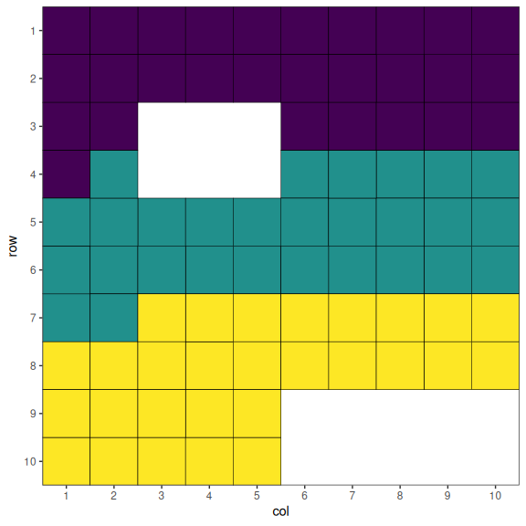
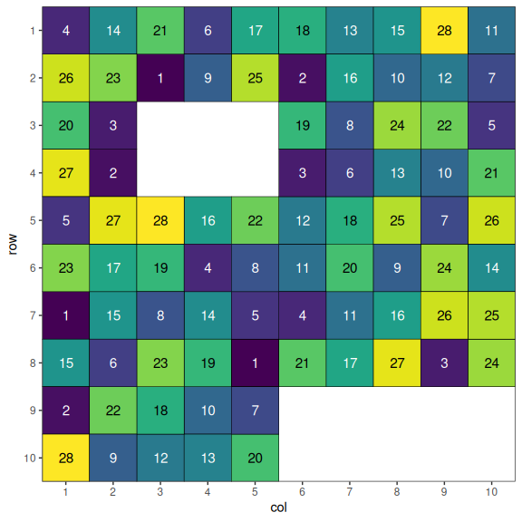
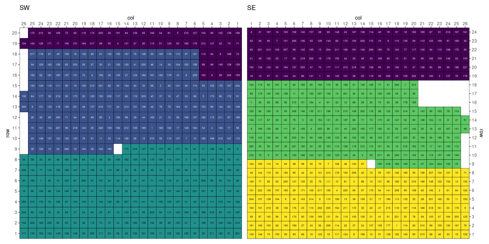
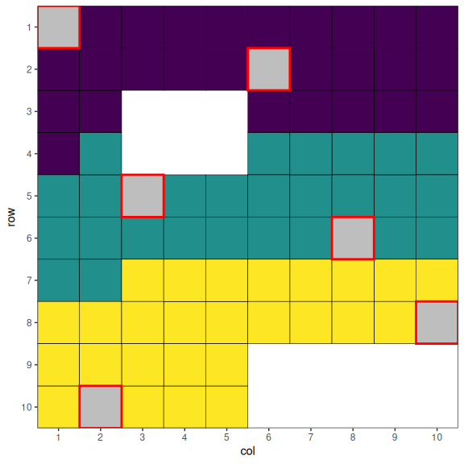
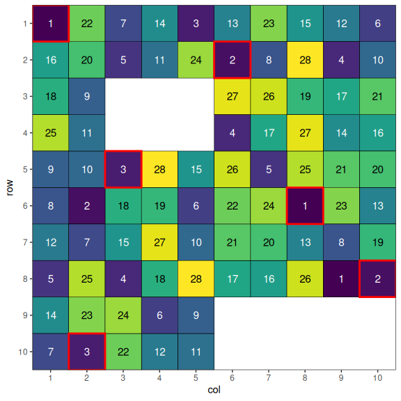

# Irregular Design

## Overview

Not every trial fully fills a whole rectangle of equally sized blocks. The plots may be unavailable because of
various reasons including but not limited to infrastructure and damage, and blocks may have to bend around them.
A design with such layout is often called an irregular design.

This vignette starts with a small irregular layout, then moves on to the more complex one from the OzBarley
elite panel trial ([Berger et al., 2026](https://doi.org/10.25909/28545575.v5)) with 222 treatments in 5
complete blocks across two areas with 34 blank plots. After the irregular designs, designs with some treatments
pre-allocated are demonstrated.


``` r
library(speed)
```

## When to Use

- Some plots in the grid cannot be used
- Blocks are not rectangular

## Structure

- **Blocks**: Blocks of any shape
- **Blank plots**: Non-experimental area
- **Sites**: Areas with their own row and column numbering, if the trial spans more than one
- **Pre-allocated plots**: Plots whose treatment is fixed in advance

::: {.callout-note}
Blank plots are removed from the data frame in these designs, rather than kept with a placeholder treatment.
They take no part in the optimisation or the scoring, and the plots show them as gaps.
:::

# Optimising a Single-Site Irregular Design

## Setting Up Irregular Design with speed

A 10 × 10 grid holds 28 treatments in 3 complete blocks. The 10 plots in rows 9-10, columns 6-10 and a 2 × 3
hole in rows 3-4, columns 3-5 are blank. Blocks are filled row by row, 28 plots at a time, so their boundaries
step part-way across rows 4 and 7.


``` r
n_treatments <- 28

simple_design <- initialise_design_df(items = 1, nrows = 10, ncols = 10)

# drop blank plots
is_blank <- with(simple_design, (row >= 9 & col >= 6) | (row %in% 3:4 & col %in% 3:5))
simple_design <- simple_design[!is_blank, ]
rownames(simple_design) <- NULL

# assign blocks row by row
simple_design$block <- NA
simple_design$block[order(simple_design$row, simple_design$col)] <- rep(1:3, each = n_treatments)
simple_design$block <- factor(simple_design$block)

# one replicate of every treatment per block
for (block in 1:3) {
  simple_design[simple_design$block == block, ]$treatment <- 1:n_treatments
}

head(simple_design)
```

```
##   row col treatment block
## 1   1   1         1     1
## 2   2   1         2     1
## 3   3   1         3     1
## 4   4   1         4     1
## 5   5   1         1     2
## 6   6   1         2     2
```

`autoplot()` outlines each block with a rectangle, which cuts across irregular blocks. A small wrapper drops
those outlines and the gridlines that show through the gaps.


``` r
autoplot_irregular <- function(object, ...) {
  if (!inherits(object, "design")) {
    class(object) <- c("design", class(object))
  }

  plt <- autoplot(object, ...)
  # block outlines are the only plain rectangles, tiles are a subclass
  is_outline <- vapply(plt$layers, function(layer) class(layer$geom)[1] == "GeomRect", logical(1))
  plt$layers <- plt$layers[!is_outline]

  return(plt + ggplot2::theme(panel.grid = ggplot2::element_blank()))
}

autoplot_irregular(simple_design, treatments = "block", size = 0)
```


{fig-align="default"}

Colours mark the blocks and blank plots are left empty.

## Performing the Optimisation


``` r
simple_result <- speed(
  data = simple_design,
  swap = "treatment",
  swap_within = "block",
  spatial_factors = ~ row + col,
  seed = 112
)
```

```
## row and col are used as row and column, respectively.
```

```
## Optimising level: single treatment within block 
## Optimal score reached at iteration 908 for level single treatment within block
```

``` r
simple_result
```

```
## Optimised Experimental Design
## ----------------------------
## Score: 4.291005 
## Iterations Run: 908 
## Stopped Early: TRUE 
## Treatments: 1, 2, 3, 4, 5, 6, 7, 8, 9, 10, 11, 12, 13, 14, 15, 16, 17, 18, 19, 20, 21, 22, 23, 24, 25, 26, 27, 28 
## Seed: 112
```

## Output of the Optimisation

No duplicated treatments along any row or column, and every block still contains each treatment exactly once.


``` r
check_no_dupes <- function(df, factors) {
  for (factor in factors) {
    cat(factor, max(table(df$treatment, df[[factor]])), "\n")
  }
}

check_no_dupes(simple_result$design_df, c("row", "col", "block"))
```

```
## row 1 
## col 1 
## block 1
```

## Visualise the Output


``` r
autoplot_irregular(simple_result)
```


{fig-align="default"}

# Optimising a Two-Site Irregular Design

## Setting Up Irregular Design with speed

The OzBarley trial has two sites, `sw` (20 rows × 26 columns) and `se` (24 rows × 26 columns), with 5 complete
blocks of 222 plots. Block 1 spans both sites. We start from two rectangular sites and then carve out the blank
plots and the irregular blocks.


``` r
n_treatments <- 222

irr_design <- initialise_design_df(
  items = 1,
  designs = list(
    sw = list(nrows = 20, ncols = 26),
    se = list(nrows = 24, ncols = 26)
  )
)

irr_design$site_col <- paste(irr_design$site, irr_design$col, sep = "_")
irr_design$site_row <- paste(irr_design$site, irr_design$row, sep = "_")

# drop blank plots
is_blank <- with(irr_design, {
  sw_blank <- (col == 26 & row %in% c(9:12, 15:18, 20)) | (col == 15 & row == 9)
  se_blank <- (col == 26 & row %in% c(15, 9:12)) | (col %in% 21:26 & row %in% 16:18) | (col == 15 & row == 9)
  (site == "sw" & sw_blank) | (site == "se" & se_blank)
})
irr_design <- irr_design[!is_blank, ]
rownames(irr_design) <- NULL

is_sw <- irr_design$site == "sw"
row <- irr_design$row
col <- irr_design$col

# assign blocks
irr_design$block <- 1
irr_design[is_sw & row <= 18 & col >= 6, ]$block <- 2
irr_design[is_sw & row <= 15, ]$block <- 2
irr_design[is_sw & row <= 9 & col <= 14, ]$block <- 3
irr_design[is_sw & row <= 8, ]$block <- 3
irr_design[!is_sw & row <= 18, ]$block <- 4
irr_design[!is_sw & row <= 9 & col <= 14, ]$block <- 5
irr_design[!is_sw & row <= 8, ]$block <- 5

# one replicate of every treatment per block
for (block in 1:5) {
  irr_design[irr_design$block == block, ]$treatment <- 1:n_treatments
}
irr_design$block <- factor(irr_design$block)

head(irr_design)
```

```
##   row col treatment site site_col site_row block
## 1   1   1         1   sw     sw_1     sw_1     3
## 2   2   1         2   sw     sw_1     sw_2     3
## 3   3   1         3   sw     sw_1     sw_3     3
## 4   4   1         4   sw     sw_1     sw_4     3
## 5   5   1         5   sw     sw_1     sw_5     3
## 6   6   1         6   sw     sw_1     sw_6     3
```

The two sites face each other, so `sw` is drawn with its columns reversed.


``` r
plot_layout_irr <- function(df, fill, title = NULL, labels = TRUE) {
  # white labels on the darker half of viridis
  df$label_colour <- ifelse(as.integer(df[[fill]]) <= nlevels(df[[fill]]) / 2, "white", "black")
  text_layer <- if (labels) {
    ggplot2::geom_text(ggplot2::aes(label = treatment, colour = label_colour), size = 1.8)
  }

  return(
    ggplot2::ggplot(df, ggplot2::aes(col, row, fill = get(fill))) +
      ggplot2::geom_tile(color = "black") +
      text_layer +
      ggplot2::scale_colour_identity() +
      ggplot2::scale_fill_viridis_d(drop = FALSE) +
      ggplot2::scale_x_continuous(expand = c(0, 0), breaks = 1:max(df$col), position = "top") +
      ggplot2::scale_y_continuous(expand = c(0, 0), breaks = 1:max(df$row)) +
      ggplot2::labs(title = title) +
      ggplot2::theme_bw() +
      ggplot2::theme(
        legend.position = "none",
        panel.grid.major = ggplot2::element_blank(),
        panel.grid.minor = ggplot2::element_blank()
      )
  )
}

autoplot_ozbarley <- function(df, labels = TRUE) {
  is_sw <- df$site == "sw"
  sw <- plot_layout_irr(df[is_sw, ], "block", "SW", labels)
  se <- plot_layout_irr(df[!is_sw, ], "block", "SE", labels)

  sw_x <- sw$scales$get_scales("x")
  sw_x$trans <- scales::reverse_trans()

  se_y <- se$scales$get_scales("y")
  se_y$position <- "right"
  return(patchwork::wrap_plots(sw, se, ncol = 2))
}

autoplot_ozbarley(irr_design, labels = FALSE)
```


{fig-align="default"}

Block 1 covers the top of both sites, while blocks 2-3 and 4-5 are confined to `sw` and `se` respectively.

## Performing the Optimisation

Treatments are swapped within blocks, so the block-1 plots of both sites form a single pool. Balance is
measured along the rows and columns of each site. As in the [MET vignette](met.html), both sites number their
rows and columns from 1, so `by = "site"` tells `speed()` that they are separate grids.


``` r
irr_result <- speed(
  data = irr_design,
  swap = "treatment",
  swap_within = "block",
  spatial_factors = ~ site_row + site_col,
  grid_factors = list(dim1 = "row", dim2 = "col", by = "site"),
  optimise_params = optim_params(random_initialisation = 10),
  adj_weight = 0,
  seed = 112
)
```

```
## row and col are used as row and column, respectively.
```

```
## Optimising level: single treatment within block 
## Level: single treatment within block Iteration: 1000 Score: 9.218214 Best: 9.200114 Since Improvement: 421 
## Optimal score reached at iteration 1760 for level single treatment within block
```

``` r
irr_result
```

```
## Optimised Experimental Design
## ----------------------------
## Score: 8.98292 
## Iterations Run: 1760 
## Stopped Early: TRUE 
## Treatments: 1, 2, 3, 4, 5, 6, 7, 8, 9, 10, 11, 12, 13, 14, 15, 16, 17, 18, 19, 20, 21, 22, 23, 24, 25, 26, 27, 28, 29, 30, 31, 32, 33, 34, 35, 36, 37, 38, 39, 40, 41, 42, 43, 44, 45, 46, 47, 48, 49, 50, 51, 52, 53, 54, 55, 56, 57, 58, 59, 60, 61, 62, 63, 64, 65, 66, 67, 68, 69, 70, 71, 72, 73, 74, 75, 76, 77, 78, 79, 80, 81, 82, 83, 84, 85, 86, 87, 88, 89, 90, 91, 92, 93, 94, 95, 96, 97, 98, 99, 100, 101, 102, 103, 104, 105, 106, 107, 108, 109, 110, 111, 112, 113, 114, 115, 116, 117, 118, 119, 120, 121, 122, 123, 124, 125, 126, 127, 128, 129, 130, 131, 132, 133, 134, 135, 136, 137, 138, 139, 140, 141, 142, 143, 144, 145, 146, 147, 148, 149, 150, 151, 152, 153, 154, 155, 156, 157, 158, 159, 160, 161, 162, 163, 164, 165, 166, 167, 168, 169, 170, 171, 172, 173, 174, 175, 176, 177, 178, 179, 180, 181, 182, 183, 184, 185, 186, 187, 188, 189, 190, 191, 192, 193, 194, 195, 196, 197, 198, 199, 200, 201, 202, 203, 204, 205, 206, 207, 208, 209, 210, 211, 212, 213, 214, 215, 216, 217, 218, 219, 220, 221, 222 
## Seed: 112
```

Block 1 is optimised as a whole, so a treatment can move between `sw` and `se` if that improves balance. Tools
that handle one rectangular grid at a time need block 1 split, or shuffled in advance, before optimising each
site separately.

## Output of the Optimisation

The output shows the final score, the number of iterations, and whether the optimisation stopped early.


``` r
str(irr_result)
```

```
## List of 9
##  $ design_df     :'data.frame':	1110 obs. of  7 variables:
##   ..$ row      : int [1:1110] 1 1 1 1 1 1 1 1 1 1 ...
##   ..$ col      : int [1:1110] 1 1 2 2 3 3 4 4 5 5 ...
##   ..$ treatment: chr [1:1110] "201" "145" "91" "146" ...
##   ..$ site     : chr [1:1110] "sw" "se" "sw" "se" ...
##   ..$ site_col : chr [1:1110] "sw_1" "se_1" "sw_2" "se_2" ...
##   ..$ site_row : chr [1:1110] "sw_1" "se_1" "sw_1" "se_1" ...
##   ..$ block    : Factor w/ 5 levels "1","2","3","4",..: 3 5 3 5 3 5 3 5 3 5 ...
##  $ score         : num 8.98
##  $ scores        : num [1:1760] 9.25 9.25 9.25 9.25 9.25 ...
##  $ temperatures  : num [1:1760] 100 99 98 97 96.1 ...
##  $ iterations_run: num 1760
##  $ stopped_early : logi TRUE
##  $ treatments    : chr [1:222] "1" "2" "3" "4" ...
##  $ seed          : num 112
##  $ metadata      :List of 6
##   ..$ levels    : chr "single treatment within block"
##   ..$ row_column: chr "row"
##   ..$ col_column: chr "col"
##   ..$ grid_by   : chr "site"
##   ..$ per_level :List of 1
##   .. ..$ single treatment within block:List of 13
##   .. .. ..$ swap            : chr "treatment"
##   .. .. ..$ spatial_factors :Class 'formula'  language ~site_row + site_col
##   .. .. .. .. ..- attr(*, ".Environment")=<environment: R_GlobalEnv> 
##   .. .. ..$ spatial_cols    : chr [1:2] "site_row" "site_col"
##   .. .. ..$ adj_weight      : num 0
##   .. .. ..$ bal_weight      : num 1
##   .. .. ..$ iterations      : num 10000
##   .. .. ..$ start_temp      : num 100
##   .. .. ..$ cooling_rate    : num 0.99
##   .. .. ..$ obj_function    :function (layout_df, swap, spatial_cols, adj_weight = 1, bal_weight = 1, 
##     row_column = "row", col_column = "col", current_score_obj = NULL, swapped_items = NULL, 
##     ...)  
##   .. .. .. ..- attr(*, "srcref")= 'srcref' int [1:8] 43 23 107 1 23 1 43 107
##   .. .. .. .. ..- attr(*, "srcfile")=Classes 'srcfilecopy', 'srcfile' <environment: 0x560d00b207a0> 
##   .. .. ..$ final_score     : num 8.98
##   .. .. ..$ final_components: Named num [1:2] 0 8.98
##   .. .. .. ..- attr(*, "names")= chr [1:2] "adjacency" "balance"
##   .. .. ..$ optimal_score   : num 8.98
##   .. .. ..$ stop_reason     : chr "optimal"
##   ..$ call      : language speed(data = irr_design, swap = "treatment", swap_within = "block", spatial_factors = ~site_row +      site_col, | __truncated__ ...
##  - attr(*, "class")= chr [1:2] "design" "list"
```

No duplicated treatments along any row, column, or block.


``` r
df <- irr_result$design_df
check_no_dupes(df, c("site_row", "site_col", "block"))
```

```
## site_row 1 
## site_col 1 
## block 1
```

## Visualise the Output


``` r
autoplot_ozbarley(df)
```


{fig-align="default"}

Rows and columns within each site are balanced, block 1 is shared across both sites, and the 34 blank plots
are left out.

# Pre-allocating Treatments

## Setting Up Pre-allocated Design with speed

Some plots may need a given treatment before optimisation starts, for example to line up with existing
equipment or a previous season. We reuse the single-site layout and fix treatments 1-3 to two plots each, in
different blocks, rows and columns.


``` r
n_treatments <- 28
prealloc <- data.frame(
  row = c(1, 2, 5, 6, 8, 10),
  col = c(1, 6, 3, 8, 10, 2),
  fixed = c(1, 2, 3, 1, 2, 3)
)

prealloc_design <- simple_design
fixed_at <- match(paste(prealloc_design$row, prealloc_design$col), paste(prealloc$row, prealloc$col))
is_fixed <- !is.na(fixed_at)

# each block still holds every treatment once
for (block in 1:3) {
  in_block <- prealloc_design$block == block
  fixed <- prealloc$fixed[fixed_at[in_block & is_fixed]]
  prealloc_design$treatment[in_block & is_fixed] <- fixed
  prealloc_design$treatment[in_block & !is_fixed] <- setdiff(1:n_treatments, fixed)
}

# pre-allocated plots have no swap group
prealloc_design$swap_group <- prealloc_design$block
prealloc_design$swap_group[is_fixed] <- NA

head(prealloc_design)
```

```
##   row col treatment block swap_group
## 1   1   1         1     1       <NA>
## 2   2   1         3     1          1
## 3   3   1         4     1          1
## 4   4   1         5     1          1
## 5   5   1         2     2          2
## 6   6   1         4     2          2
```


``` r
autoplot_irregular(prealloc_design, treatments = "swap_group", size = 0) +
  ggplot2::geom_tile(ggplot2::aes(col, row), data = prealloc, fill = "grey", colour = "red", linewidth = 1)
```


{fig-align="default"}

Colours mark the swap groups. Pre-allocated plots, in grey with a red outline, belong to none.

## Performing the Optimisation

`swap_within` points to `swap_group`, which is `NA` for the pre-allocated plots, so they are never swapped. They
are still part of the scoring, and the free copies of treatments 1-3 count against them. A free plot of
treatment 1 is therefore kept out of rows 1 and 6 and columns 1 and 8, where treatment 1 is already fixed.


``` r
prealloc_result <- speed(
  data = prealloc_design,
  swap = "treatment",
  swap_within = "swap_group",
  spatial_factors = ~ row + col,
  seed = 112
)
```

```
## row and col are used as row and column, respectively.
```

```
## Optimising level: single treatment within swap_group 
## Optimal score reached at iteration 886 for level single treatment within swap_group
```

``` r
prealloc_result
```

```
## Optimised Experimental Design
## ----------------------------
## Score: 4.291005 
## Iterations Run: 886 
## Stopped Early: TRUE 
## Treatments: 1, 2, 3, 4, 5, 6, 7, 8, 9, 10, 11, 12, 13, 14, 15, 16, 17, 18, 19, 20, 21, 22, 23, 24, 25, 26, 27, 28 
## Seed: 112
```

## Output of the Optimisation

No duplicated treatments along any row, column, or block, pre-allocated plots included.


``` r
df <- prealloc_result$design_df
check_no_dupes(df, c("row", "col", "block"))
```

```
## row 1 
## col 1 
## block 1
```

Every pre-allocated plot keeps its treatment.


``` r
fixed_after <- merge(df, prealloc, by = c("row", "col"))
all(fixed_after$treatment == fixed_after$fixed)
```

```
## [1] TRUE
```

## Visualise the Output


``` r
autoplot_irregular(prealloc_result) +
  ggplot2::geom_tile(ggplot2::aes(col, row), data = prealloc, fill = NA, colour = "red", linewidth = 1)
```


{fig-align="default"}

Pre-allocated plots are outlined in red.

# Spatial Design Considerations

## Field Shape and Orientation

## Neighbour Effects

# Using `speed` Effectively

1. **Set appropriate parameters**: Balance optimisation time with improvement <!-- Link to vignette on parameters -->
2. **[Visualise designs](autoplot.html)**: Always plot layouts before implementation  <!-- Link to autoplot -->
3. **Compare alternatives**: Test multiple blocking strategies
4. **Validate results**: Check constraint satisfaction and efficiency metrics

# Conclusion

## Further Reading

- Berger, B. et al. (2026). OzBarley: phenotypic data of the OzBarley elite panel collected in greenhouse trials
  at the Australian Plant Phenomics Network, University of Adelaide. The University of Adelaide. Dataset.
  <https://doi.org/10.25909/28545575.v5>

# Related Vignettes

- [Multi-Environment Trials](met.html)

*This vignette demonstrates the versatility of the `speed` package for agricultural experimental design. For more advanced applications and custom designs, consult the package documentation and additional vignettes.*
